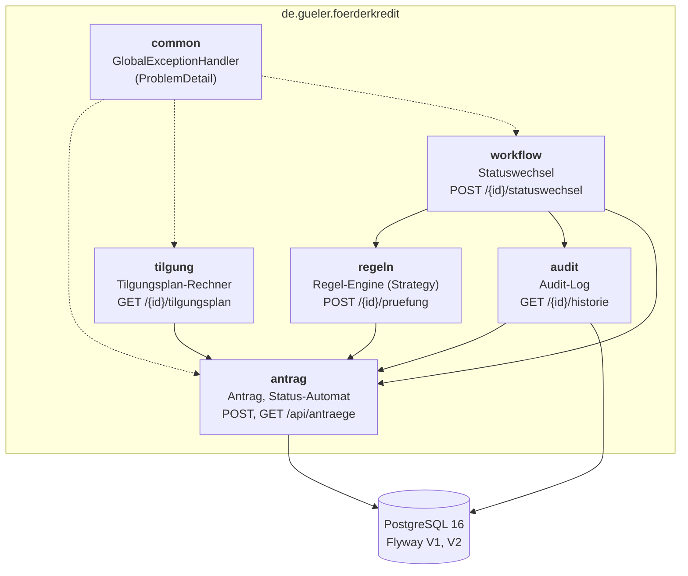
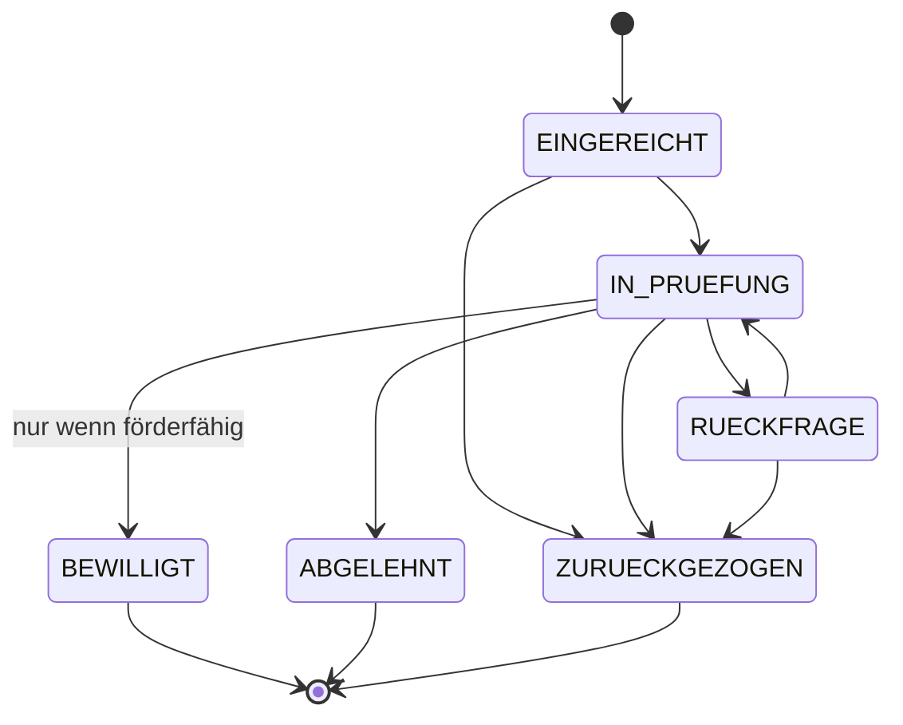

# Förderkredit-Service

[](https://github.com/fatihgueler/foerderkredit-service/actions/workflows/ci.yml)

Ein REST-Backend in Java 21 und Spring Boot, das Anträge auf Förderkredite annimmt und speichert.
Es prüft jeden Antrag gegen einen Satz von Förderregeln, berechnet einen monatlichen Tilgungsplan
für ein Annuitätendarlehen und führt den Antrag durch einen Bearbeitungs-Workflow.
Jeder Statuswechsel wird revisionssicher in einem Audit-Log festgehalten.

> **Hinweis: Alle Förderregeln in diesem Projekt sind FIKTIV.** Sie dienen nur zur Demonstration
> und entsprechen keinem echten Förderprogramm einer Förderbank oder Behörde.

Portfolio-Projekt von Fatih Güler (Umschulung Fachinformatiker Anwendungsentwicklung).

---

## Inhalt

- [Architektur](#architektur)
- [Technik](#technik)
- [Starten](#starten)
- [API und Beispiel-Requests](#api-und-beispiel-requests)
- [Teststrategie](#teststrategie)
- [Fachliche Entscheidungen](#fachliche-entscheidungen)
- [Die fiktiven Förderregeln](#die-fiktiven-förderregeln)

---

## Architektur

Der Code ist nach **Fachlichkeit** gegliedert, nicht nach technischer Schicht. Jedes Paket enthält
seinen eigenen Controller, Service, DTOs und gegebenenfalls Entity und Repository.



Alle Abhängigkeiten zeigen in eine Richtung, zum Paket `antrag`. Es gibt keine Zyklen.
`common` kennt nur die Exceptions der anderen Pakete, um sie in HTTP-Antworten zu übersetzen.

| Paket      | Aufgabe |
|------------|---------|
| `antrag`   | Antrag anlegen, lesen, auflisten. Enthält die Entity `Antrag` und das Enum `AntragStatus` mit den erlaubten Übergängen. |
| `regeln`   | Interface `Foerderregel` und fünf fiktive Regeln. `FoerderpruefungService` wendet alle an. |
| `tilgung`  | `TilgungsplanRechner` (reines Java, ohne Spring) und Endpoint. |
| `workflow` | Statuswechsel mit Prüfung gegen den Zustandsautomaten und die Förderregeln. |
| `audit`    | Unveränderliches Audit-Log der Statuswechsel und Historie-Endpoint. |
| `common`   | Zentrale Fehlerbehandlung: alle Fehler als RFC-9457-`ProblemDetail` mit deutscher Meldung. |

---

## Technik

Java 21 · Spring Boot 3.5 (Web, Data JPA, Validation) · PostgreSQL 16 · Flyway · springdoc-openapi
(Swagger-UI) · JUnit 5 · AssertJ · Mockito · Testcontainers · Docker Compose · GitHub Actions.

Bewusst **nicht** verwendet: Lombok, Spring Security, Frontend, Messaging/Caching.

---

## Starten

**Voraussetzungen:** JDK 21 und Docker (für die Datenbank). Maven muss **nicht** installiert sein,
das Projekt bringt den Maven Wrapper (`mvnw` bzw. `mvnw.cmd`) mit.

```bash
docker compose up -d
```

```bash
./mvnw spring-boot:run
```

Unter Windows (PowerShell oder CMD) statt `./mvnw` einfach `mvnw.cmd` verwenden:

```bash
mvnw.cmd spring-boot:run
```

Danach:

- API: <http://localhost:8080/api/antraege>
- Swagger-UI: <http://localhost:8080/swagger-ui.html>
- OpenAPI-JSON: <http://localhost:8080/v3/api-docs>

Flyway legt das Datenbankschema beim Start automatisch an. Hibernate ändert das Schema nie selbst
(`ddl-auto=validate`). Die Verbindungsdaten lassen sich mit den Umgebungsvariablen `DB_URL`,
`DB_USER` und `DB_PASSWORD` überschreiben. Die Datenbank stoppen: `docker compose down`.

---

## API und Beispiel-Requests

| Methode | Pfad | Zweck |
|---------|------|-------|
| POST | `/api/antraege` | Antrag anlegen (201 + `Location`-Header) |
| GET  | `/api/antraege/{id}` | Antrag lesen |
| GET  | `/api/antraege?status=…&page=0&size=20` | Anträge auflisten, optional nach Status, paginiert |
| POST | `/api/antraege/{id}/pruefung` | Alle Förderregeln prüfen |
| GET  | `/api/antraege/{id}/tilgungsplan` | Tilgungsplan berechnen |
| POST | `/api/antraege/{id}/statuswechsel` | Status ändern |
| GET  | `/api/antraege/{id}/historie` | Alle Statuswechsel (Audit-Log) |

### Antrag anlegen

```bash
curl -i -X POST http://localhost:8080/api/antraege \
  -H "Content-Type: application/json" \
  -d '{
        "antragstellerName": "Muster Tischlerei GmbH",
        "rechtsform": "GMBH",
        "branche": "HANDWERK",
        "bundesland": "NIEDERSACHSEN",
        "mitarbeiterAnzahl": 25,
        "jahresumsatz": 3500000.00,
        "kreditbetrag": 100000.00,
        "laufzeitJahre": 10,
        "tilgungsfreieJahre": 1,
        "sollzinsProzent": 4.0,
        "verwendungszweck": "Kauf einer CNC-Fräsmaschine"
      }'
```

Die Antwort enthält die `id` des Antrags. Für die folgenden Beispiele in eine Variable übernehmen:

```bash
ID=<id aus der Antwort>
```

### Anträge auflisten, prüfen, Tilgungsplan

```bash
curl "http://localhost:8080/api/antraege?status=EINGEREICHT&page=0&size=10"
```

```bash
curl -X POST http://localhost:8080/api/antraege/$ID/pruefung
```

```bash
curl http://localhost:8080/api/antraege/$ID/tilgungsplan
```

### Workflow: in Prüfung nehmen, bewilligen, Historie

```bash
curl -X POST http://localhost:8080/api/antraege/$ID/statuswechsel \
  -H "Content-Type: application/json" \
  -d '{"neuerStatus": "IN_PRUEFUNG", "kommentar": "Unterlagen vollständig", "bearbeiter": "m.mueller"}'
```

```bash
curl -X POST http://localhost:8080/api/antraege/$ID/statuswechsel \
  -H "Content-Type: application/json" \
  -d '{"neuerStatus": "BEWILLIGT", "kommentar": "Alle Regeln erfüllt", "bearbeiter": "m.mueller"}'
```

```bash
curl http://localhost:8080/api/antraege/$ID/historie
```

### Fehlerantworten (RFC 9457 `ProblemDetail`)

Alle Fehler kommen als `application/problem+json`. Beispiel für einen verbotenen Statuswechsel:

```json
{
  "type": "about:blank",
  "title": "Statuswechsel nicht erlaubt",
  "status": 409,
  "detail": "Ein Wechsel von EINGEREICHT nach BEWILLIGT ist nicht erlaubt.",
  "instance": "/api/antraege/46e53100-.../statuswechsel",
  "aktuellerStatus": "EINGEREICHT",
  "gewuenschterStatus": "BEWILLIGT",
  "erlaubteFolgestatus": ["IN_PRUEFUNG", "ZURUECKGEZOGEN"]
}
```

| Status | Wann |
|--------|------|
| 400 | Validierungsfehler (Feld `fehler` mit einer deutschen Meldung pro Feld), ungültiges JSON, unbekannter Enum-Wert, ungültige UUID |
| 404 | Antrag existiert nicht |
| 409 | Statuswechsel im Zustandsautomaten nicht erlaubt |
| 422 | Bewilligung, obwohl nicht förderfähig (Feld `nichtErfuellteRegeln`), oder kein Tilgungsplan berechenbar |

---

## Teststrategie

```bash
./mvnw verify
```

`verify` führt zuerst alle Unit- und Slice-Tests (`*Test`, Surefire) und danach die
Integrationstests (`*IT`, Failsafe) aus.

| Ebene | Werkzeuge | Beispiele |
|-------|-----------|-----------|
| **Unit-Tests** (ohne Spring) | JUnit 5, AssertJ, Mockito | `TilgungsplanRechnerTest` (von Hand nachgerechnetes Beispiel + Grenzfälle), je Regel ein Test für erfüllt/nicht erfüllt, `ZustandsautomatTest` (alle erlaubten und 7 benannte verbotene Übergänge), Service-Tests mit Mocks |
| **Web-Slice-Tests** | `@WebMvcTest`, MockMvc | Ein Test je Controller: JSON-Format, Validierungsfehler (400), 404, 409, 422 |
| **Spring-Kontext-Test** | `@SpringJUnitConfig` | `RegelRegistrierungTest`: findet Spring wirklich alle fünf Regeln? |
| **Integrationstests** | `@SpringBootTest`, Testcontainers (PostgreSQL 16) | `AntragLebenszyklusIT`: anlegen → prüfen → bewilligen → Historie hat 2 Einträge; Rollback bei 422. `AntragRepositoryIT`: Flyway-Schema passt zu den Entities |

Die erwarteten Werte im Tilgungsplan-Test stammen **nicht** aus dem getesteten Code. Der Rechenweg
steht als Kommentar im Test, und die Werte wurden zusätzlich unabhängig nachgerechnet.

Testnamen sind deutsche Sätze, die das erwartete Verhalten beschreiben, z. B.
`lehntUebergangVonBewilligtNachInPruefungAb()`.

### Integrationstests ohne Docker

Die Integrationstests sind mit `@Testcontainers(disabledWithoutDocker = true)` markiert.
**Läuft lokal kein Docker, werden sie übersprungen** (gelb statt rot), alle anderen Tests laufen
normal. In GitHub Actions ist Docker vorhanden, dort laufen sie bei jedem Push und Pull Request
(`.github/workflows/ci.yml`).

---

## Fachliche Entscheidungen

### BigDecimal statt double

Geldbeträge sind überall `BigDecimal` und in der Datenbank `NUMERIC(15,2)`. `double` speichert Zahlen
binär und kann z. B. 0,1 nicht exakt darstellen (`0.1 + 0.2 = 0.30000000000000004`). Bei Geld
darf aber kein Cent verloren gehen. Vergleiche laufen mit `compareTo`, nicht mit `equals`, weil
`equals` auch die Anzahl der Nachkommastellen vergleicht (`10.0` ≠ `10.00`).

### Rundung

- Zwischenergebnisse (Monatszins 0,04/12 = 0,00333…, Potenzen, Annuität) werden mit
  `MathContext.DECIMAL128` (34 signifikante Stellen) berechnet und **nicht** gerundet.
- Jeder Betrag, der im Tilgungsplan steht, wird auf **2 Nachkommastellen mit `RoundingMode.HALF_UP`**
  (kaufmännisch) gerundet.
- Durch das Runden bleibt am Ende eine kleine Differenz. Die **letzte Rate tilgt genau die
  Restschuld**, sodass die Restschuld am Ende exakt 0,00 € ist.

Beispiel: 100.000 €, 4 %, 10 Jahre, 1 Jahr tilgungsfrei → 12 Monate je 333,33 € Zinsen,
dann 107 Raten zu 1.104,10 € und eine Schlussrate von 1.103,68 €; Gesamtzinsen 23.242,34 €.

### Zustandsautomat



Die erlaubten Übergänge stehen an **einer einzigen Stelle**: `AntragStatus.erlaubteFolgestatus()`.
Der `switch` darin hat keinen `default`-Zweig, sodass der Compiler bei einem neuen Status meldet,
dass dessen Übergänge noch fehlen. Ein verbotener Übergang ergibt **409 Conflict**.
`BEWILLIGT` ist zusätzlich nur erlaubt, wenn die Förderprüfung im selben Moment
`foerderfaehig = true` ergibt, sonst **422**.

Statuswechsel und Audit-Eintrag laufen in **derselben Transaktion**. `AuditService.protokolliere`
ist mit `Propagation.MANDATORY` markiert und lässt sich gar nicht außerhalb einer laufenden
Transaktion aufrufen. Schlägt etwas fehl, wird beides zurückgerollt.

Das Audit-Log ist **nur zum Anhängen** gedacht: Die Entity ist `@Immutable` und hat keine Setter, und
das Repository erweitert nur `Repository` (nicht `JpaRepository`), sodass es keine `delete`-Methode gibt.

### Strategy-Pattern für die Förderregeln

Jede Regel implementiert das Interface `Foerderregel` und ist eine eigene `@Component`. Spring
übergibt alle Regeln als `List<Foerderregel>` an den `FoerderpruefungService`. Eine neue Regel
bedeutet **eine neue Klasse**, bestehender Code ändert sich nicht (Open-Closed-Prinzip). Die
Prüfung bricht nicht beim ersten Fehler ab, sondern liefert immer alle Regelergebnisse mit Begründung.

### Validierung vs. Förderregeln

Bean Validation prüft nur das **Format** einer Anfrage (Pflichtfelder, Längen, Zahlenformat) → 400.
Ob ein Antrag **förderfähig** ist, entscheiden die Regeln. Ein formal korrekter Antrag über 5.000 €
wird also gespeichert, ist aber nicht förderfähig.

---

## Die fiktiven Förderregeln

> **Alle Regeln sind FIKTIV** und nur für dieses Demonstrationsprojekt ausgedacht.

| Regel | Bedingung |
|-------|-----------|
| `KreditbetragRegel` | Kreditbetrag zwischen 10.000 € und 2.000.000 € (inklusive) |
| `KmuRegel` | weniger als 250 Mitarbeitende **und** Jahresumsatz bis 50 Mio. € |
| `StandortRegel` | Sitz in Niedersachsen |
| `BranchenRegel` | Branche nicht auf der Ausschlussliste (`GLUECKSSPIEL`, `WAFFEN`) |
| `LaufzeitRegel` | Laufzeit 2 bis 20 Jahre, höchstens 3 tilgungsfreie Jahre, tilgungsfreie Jahre kleiner als die Laufzeit |

Ein Antrag ist förderfähig, wenn **alle** Regeln erfüllt sind.
